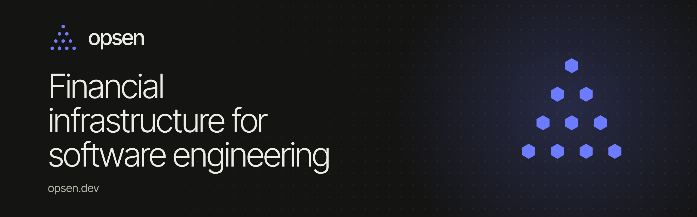

opsen prices every seat, licence, CI minute and agent token against the code your team ships. Every week, opsen removes the spend that ships nothing. You pay from the savings.

**[Start a free audit](https://opsen.dev/signup)** · [Live demo](https://opsen.dev/demo) · [Docs](https://opsen.dev/docs) · [Security](https://opsen.dev/security) · [Changelog](https://opsen.dev/changelog)

| Repository | What it is |
| --- | --- |
| [plugins](https://github.com/opsen-dev/plugins) | opsen for Claude Code, Cursor and Codex: spend, waste and the fixes for it, from your editor |
| [report-action](https://github.com/opsen-dev/report-action) | Engineering spend and waste in your job summary, with a threshold that fails the job |
| [skills](https://github.com/opsen-dev/skills) | Agent skills that answer spend questions from your opsen report |
| [examples](https://github.com/opsen-dev/examples) | Slack digests, warehouse exports and budget gates from the report JSON |
| [report-schema](https://github.com/opsen-dev/report-schema) | The JSON Schema for the opsen report |

Found a vulnerability? Email support@opsen.dev with the subject *Security*.
